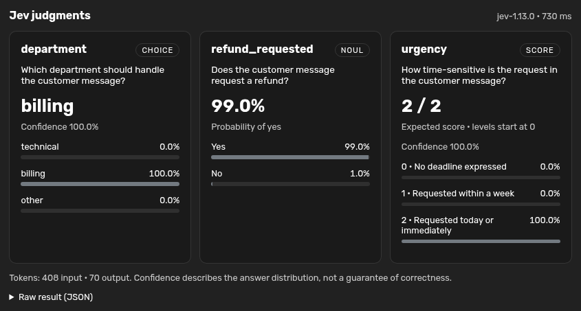

# TypeSafe AI for Agent Zero

Ask **Jev** focused questions and get typed answers with probability cards in Agent Zero's chat. One `typesafe_query` call can combine Choice, Noul, and Score questions over the same evidence.

This community plugin uses the [official TypeSafe Python SDK](https://docs.typesafe.ai/sdk/python) and includes the official [TypeSafe agent skill](https://docs.typesafe.ai/agent-skill), unchanged with its MIT license. It is not an official TypeSafe or Agent Zero product.



## Settings

| Setting | Default | Purpose |
| --- | --- | --- |
| API key | Empty | Masked field with reveal control; overrides the fallback key. |
| Model | `jev-latest` | Jev model alias or a version available to your account. |
| Request timeout | 30 seconds | Per HTTP attempt, from 1 to 300 seconds. |

The fallback is `TYPESAFE_API_KEY` from Agent Zero's secret store (including project secrets), then the framework's process environment. Get a key from the [TypeSafe console](https://console.typesafe.ai/). Settings support project and agent-profile scopes. Keys entered here are stored in Agent Zero's local plugin configuration; do not share `config.json` or runtime backups. The repository excludes runtime configuration and credentials.

Only the explicit `state` and `questions` are sent to TypeSafe. Requests use your account and may incur TypeSafe usage charges. API keys are never tool arguments or result fields. The SDK retries transient failures once, within its retry budget; authentication and validation errors are returned to the agent without exposing provider response bodies.

## Use

Ask Agent Zero:

> Use Jev to classify this message as billing, technical, or other, check whether a refund is requested, and score its urgency in one call: “I was charged twice. Please refund the duplicate today.”

Or call `typesafe_query` with:

```json
{
  "state": {"message": "I was charged twice. Please refund the duplicate today."},
  "questions": {
    "department": {
      "type": "choice",
      "instructions": "Which team should handle `message`?",
      "criteria": {"billing": "Payments and refunds", "technical": "Software problems", "other": "Neither fits"}
    },
    "refund_requested": {"type": "noul", "instructions": "Does `message` request a refund?"},
    "urgency": {
      "type": "score",
      "instructions": "How time-sensitive is the request in `message`?",
      "criteria": ["No deadline", "Within a week", "Today or immediately"]
    }
  }
}
```

Expand the **JEV** process step to see result cards, distributions, token counts, elapsed time, and raw JSON. Results use the existing `tool` log type, so saved chats have a generic JSON fallback when the plugin is disabled. Rendering uses text nodes for question text, labels, and provider values.

Noul is a probability of **yes**, with no separate confidence. Score is an expected position on zero-indexed rubric levels, not a percentage. Choice/Score confidence describes distribution concentration, not overall correctness. Jev produces judgments, not prose explanations; validate decisions on your own data. Independent questions should share one call. Consult the bundled `typesafe-ai` skill for composition and prompting guidance.

## Updates and removal

Lifecycle hooks are safe to rerun. Updates refresh unchanged plugin-owned skill files and preserve pre-existing or edited skill files. `uninstall()` removes only unchanged skill files recorded as installed by this plugin. It preserves user edits, unrelated files, keys in Agent Zero's environment/secrets, and shared Python packages. The framework removes the plugin directory, including its local configuration. Scoped configuration removal follows Agent Zero's normal plugin management behavior.

## License

Plugin: MIT. The bundled official skill retains its own TypeSafe AI copyright and MIT license in `resources/typesafe-ai/LICENSE`.
